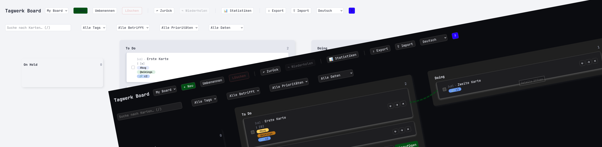

# Tagwerk

[🇬🇧 English](README.md) | [🇩🇪 Deutsch](README.de.md) | [🇫🇷 Français](README.fr.md) | [🇮🇹 Italiano](README.it.md) | [🇵🇱 Polski](README.pl.md) | [🇪🇸 Español](README.es.md) | [🇳🇱 Nederlands](README.nl.md) | [🇨🇿 Čeština](README.cs.md)

---

Pruébalo en vivo: [https://adrianbadertscher.github.io/tagwerk-board/](https://adrianbadertscher.github.io/tagwerk-board/)

Tu tablero Kanban personal. Tus datos se quedan en tu dispositivo. Sin más.

Tagwerk es un tablero Kanban privado y local-first, construido por completo con HTML, JavaScript y CSS — sin servidor, sin cuentas, sin nube, sin paso de compilación. Abre los archivos y funciona. Tus tareas nunca abandonan tu máquina, y precisamente por eso Tagwerk no está hecho para equipos. Es tu tablero, para tu trabajo.

## ¿Por qué Tagwerk?

La mayoría de las herramientas Kanban quieren tus datos. Los sincronizan, analizan, alojan y monetizan. Tagwerk toma la postura contraria: no hay nada que interceptar ni nada que filtrar, porque todo se ejecuta y se guarda localmente en tu navegador. Privado por diseño, no por política.

Si trabajas solo — como desarrollador, escritor, investigador o planificador — no necesitas una plataforma de colaboración. Necesitas un tablero rápido y bonito que respete tu privacidad. Eso es Tagwerk.

## Características

- **Varios tableros** — crea, renombra y borra tableros; organiza por proyecto o mantén un tablero de archivo
- **Tarjetas ricas** — título, descripción en Markdown con vista previa en vivo, fecha de vencimiento (con día de la semana), etiquetas y un campo «Afecta a»
- **Prioridades con código de colores** — cada tarjeta lleva una prioridad alta / media / baja, mostrada como franja de color en el borde de la tarjeta: verde para baja, ámbar para media, rojo para alta. Recorre una columna con la vista y ve al instante qué merece tu atención primero — y retoma exactamente donde lo dejaste semanas después
- **Historial trazable por tarjeta** — cada tarjeta guarda su propio registro de cambios: qué cambió, cuándo y de qué a qué — ediciones de título, cambios de prioridad, movimientos de fecha, actualizaciones de etiquetas y transiciones de columna («Movida: Doing → Done»). El registro vive en la vista de detalle de la tarjeta, lo más reciente primero, con límite de las últimas 30 entradas
- **Selección múltiple** — marca las casillas de varias tarjetas a la vez y envía todo el lote a otro tablero con «Mover a tablero» (p. ej. tu archivo o un tablero de proyecto dedicado). Identificadores nuevos a la llegada evitan colisiones; el drag & drop sigue funcionando aunque los filtros oculten tarjetas
- **Conexiones visibles** — las tarjetas enlazadas se unen mediante hilos animados («cuerdas») dibujados sobre el tablero; al pasar el cursor sobre una tarjeta sus cuerdas brillan mientras las demás se atenúan
- **Columna On Hold** — un carril de aparcamiento deliberado para el trabajo bloqueado, junto a To Do, Doing y Done
- **Filtrado y búsqueda potentes** — filtra por etiqueta, afecta a, prioridad y fecha (vencida, vence hoy, próximos 7 días, sin fecha); búsqueda instantánea sobre títulos y descripciones con coincidencias resaltadas. Las tarjetas vencidas reciben un resalte rojo, las que vencen hoy uno naranja — el tablero te avisa antes incluso de que leas
- **Enlaces bidireccionales** — enlaza tarjetas entre sí; ambos extremos se mantienen sincronizados automáticamente
- **Deshacer / rehacer** — Ctrl+Z / Ctrl+Y (o Ctrl+Shift+Z), por sesión y por tablero
- **Límites WIP** — configurables por columna, con avisos visuales al superarlos
- **Vista de estadísticas** — totales, vencidas, vencen hoy, porcentaje de finalización, desglose por prioridad y un gráfico de barras de tarjetas por columna
- **Atajos de teclado en todas partes** — / para buscar, n nueva tarea, s estadísticas, ? ayuda, Ctrl+S exportar
- **Enlaces profundos** — comparte un fragmento de URL como index.html?detail-id=c42 para abrir directamente una tarjeta concreta
- **Drag & drop** — arrastre fluido de tarjetas entre y dentro de columnas, con indicador de colocación; los botones de flecha son una alternativa táctil
- **Tema claro y oscuro** — sigue automáticamente la preferencia de tu sistema

## Exportación e importación

- **Ctrl+S** o el botón Exportar respalda todos los tableros a la vez en un único archivo JSON con marca de tiempo — exportaciones consecutivas nunca se sobrescriben
- La importación acepta tanto un paquete completo como una exportación clásica de un solo tablero; las importaciones siempre llegan como tableros nuevos, así nunca se sobrescribe nada existente y una única entrada corrupta jamás hunde el resto de la copia de seguridad
- El historial de cambios de cada tarjeta viaja con cada tarjeta exportada y movida — tu pista de auditoría sobrevive al viaje
- Un enlace profundo lleva en todo momento a las tarjetas archivadas — oculto no significa perdido

## 8 idiomas

Alemán, inglés, francés, italiano, polaco, español, neerlandés y checo — detectados automáticamente desde tu navegador, cambiables en cualquier momento, guardados localmente. Incluso las abreviaturas de los días siguen el idioma activo.

## Privacidad por diseño

- Sin servidor, sin telemetría, sin analítica — Tagwerk no envía nada a ninguna parte
- Solo almacenamiento local — tus tableros viven en el localStorage de tu navegador, en tu dispositivo
- Importaciones validadas — los datos importados se depuran y comprueban contra un esquema, no se confía en ellos a ciegas
- Cero dependencias — cuatro archivos, HTML/CSS/JS puro; puedes leer cada línea

## Primeros pasos

Sin instalación. Sin registro. Sin proceso de compilación.

- Descarga o clona este repositorio
- Abre `index.html` en un navegador moderno
- Crea tu primera tarjeta

Eso es todo. Tus datos están en tu dispositivo — y en ningún otro sitio.

### Pila tecnológica

| Capa | Tecnología |
| --- | --- |
| Estructura | HTML semántico con modales `<dialog>` |
| Lógica | JavaScript puro (ES6+) |
| Estilos | CSS escrito a mano, propiedades personalizadas, `prefers-color-scheme` |
| Almacenamiento | localStorage (por tablero, más metadatos de tableros) |
| Dependencias | Ninguna |

Funciona sin conexión, desde una carpeta local o alojado en cualquier servidor de archivos estáticos (p. ej. GitHub Pages).

## No es para equipos — y está orgulloso de ello

Tagwerk es deliberadamente de usuario único. Sin avatares, sin menciones, sin feeds de actividad, sin notificaciones peleando por tu atención. Si necesitas colaborar, usa una herramienta de equipo con tu equipo. Cuando eres solo tú y tu trabajo, Tagwerk te da concentración — sin regalar tus datos.

> Distribuido con JetBrains Mono, © The JetBrains Mono Project Authors, SIL Open Font License 1.1 — ver `fonts/OFL.txt`

Simple, local y solo tuyo. Prueba Tagwerk hoy.
